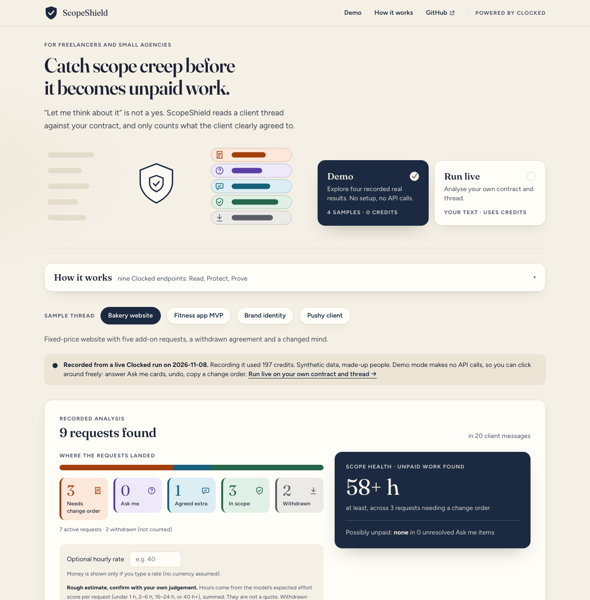
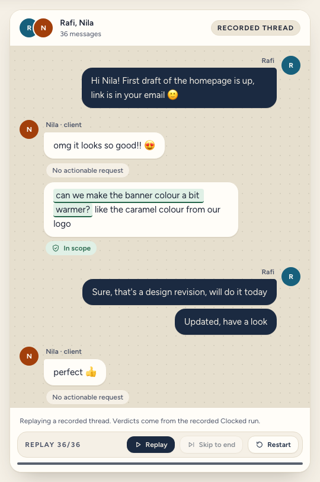
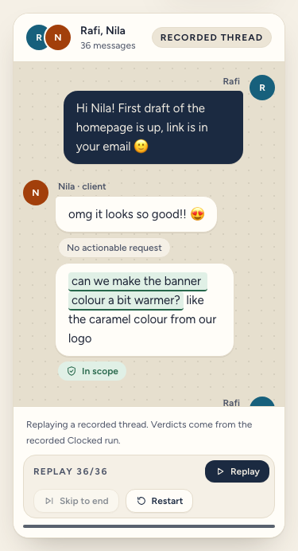

# ScopeShield

ScopeShield reads a freelancer's contract and a client chat thread, finds the requests the client made, and tells you which ones are outside the agreement, which the client actually agreed to pay for, and which they later withdrew.

**Live demo:** https://scopeshield.anamulhoque.com (fallback: https://scopeshield-1la.pages.dev). Demo mode needs no key and makes no API calls.

<p align="center">
  
</p>

<p align="center">
  
  &nbsp;
  
</p>

A full-page desktop capture is in [docs/screenshots/desktop-bakery.png](docs/screenshots/desktop-bakery.png). Screenshots are regenerated with `node scripts/screenshots.mjs`.

## The problem

Scope creep is rarely one big demand. It is a string of small asks, answered with "sure" or "let me think about it", until nobody agrees on what was promised. "Let me think about it" is not a yes, and a request for a price is not an agreement. Freelancers and small agencies absorb the cost as unpaid work.

## What it does

Paste a contract and a thread, or open one of four synthetic samples. ScopeShield sorts every client request it finds into five queues: needs change order, ask me, agreed extra, in scope, and withdrawn. Each verdict shows the client's own sentence highlighted in the thread, plus the probabilities behind it and the contract clause that governs the request. For work that needs a change order it drafts a short, polite message and a next step, then checks every claim in that draft against the contract and the thread before you can copy it. A Scope Health summary shows rough unpaid hours, clearly labelled as estimates.

Around that sits one calm "Safety and evidence" area: **Guard** screens the client's messages for text that tries to instruct the analysis tool itself (and withholds it from the model if it does), a **Promise check** compares your own messages with the contract, and a **privacy-safe evidence pack** gives you a masked copy of the evidence for one request.

**What is different:** the uncertain middle is a feature. When Clocked is not sure, ScopeShield asks you one concrete question instead of guessing, and records your decision. Missing facts stay visible, for example "No price was quoted in this thread". Every model judgment is labelled as an estimate, never as a fact.

**Who it is for:** freelancers and small agencies who agree work in chat and email.

**How to try it:** Demo mode replays recorded live Clocked results (four synthetic threads, including a "Pushy client" one that exercises Guard and the Promise check) and makes no API calls. Run live analyses your own text. All sample data is synthetic: made-up people and companies.

## How ScopeShield uses Clocked

ScopeShield uses nine endpoints: Read (Extract, Decide, Fill), Protect (Guard, Protect, Inspect), Prove (Verify, Rerank, Compare). Together they form one pipeline: Read understands the thread and the contract, Protect keeps the analysis and your data safe, Prove checks what is said against the sources. Each output changes what the app does or shows.

| Group | Clocked endpoint | What it decides | What changes in the app |
|---|---|---|---|
| Read | **Extract** (`/extract`) | Which sentences in each client message are separate requests, with their position in the thread. Also the agreement or withdrawal sentence and, for agreed work, the price quoted for that request. | Builds the request list and the evidence highlights in the thread. An empty result is shown as "No actionable request". Agreed extra cards show the agreement sentence and "Agreed price" (or "No price found in the thread"). |
| Read | **Decide** (`/decide`) | For each request, on the contract plus the full thread: the probability that it is outside the contract, that the client clearly agreed to pay, and that they later withdrew it, plus a kind tag and an effort score. | The app applies its own thresholds to route the request to a queue, draws the probability bars, triggers the Ask me question for uncertain results, and feeds the rough hour estimate. |
| Read | **Fill** (`/fill`) | For a change-order request: category, unpaid risk, the price quoted (if any), a short message to the client and a next step. | Creates the change-order card. Generated text is labelled "AI-generated draft". Decide's effort and agreement results are passed into Fill's instructions, so a large job with no agreement cannot be rated low risk. |
| Protect | **Guard** (`/injection`) | Whether the client's messages try to instruct the analysis tool (ignore the rules, mark things in scope or paid, reveal prompts). One call over the client's messages only. Ordinary requests, pressure and discount asks are not injection. | A flagged message gets a warning chip in the chat and a banner. Its text is replaced by "[message withheld: possible instruction to the analysis tool]" in everything Decide, Fill, Verify and the lookups see. "Include anyway" is your recorded choice. |
| Protect | **Protect** (`/pii`) | Names, emails, phones, addresses and bank or card numbers in an "evidence pack" assembled for one request. | Offers a masked copy to download or copy, with "Found and masked: N items (by kind)". Your original text is never altered. "Detection can miss sensitive data. Review before sharing." |
| Protect | **Inspect** (`/script`) | Whether a code snippet the client pasted (a tracking tag, a script to install) looks routine, suspicious or harmful. Deterministic detection first (code fence, `<script`, function with braces, `curl ... \| sh`, PowerShell cmdlets); at most 3 snippets, each up to 5,000 characters; no call when there is none. The snippet is treated as untrusted text and never run. | The request card gets a "Client-supplied script" row with the risk (model estimate), the flagged lines in a code block and "Show in thread". If flagged, Fill's next step asks the client for the snippet's source and not to install it until that is confirmed. "A benign result is not a safety guarantee. Read the code yourself." |
| Prove | **Verify** (`/grounding`) | Whether each factual claim in the generated message is supported by, contradicted by, or not stated in two named sources: the contract and the thread. | A contradicted claim blocks Copy and shows the evidence. A not-stated claim shows a note and needs one acknowledgement. Supported claims are counted. |
| Prove | **Compare** (`/compare`) | Where your own messages may conflict with the contract, for example offering excluded work at no cost or more revisions than agreed. One call per analysis. | A "Promise check" panel lists each possible conflict with both quotes and a link into the chat, labelled "Possible conflict, please review", or "No conflicts found in your messages". Never a verdict. |
| Prove | **Rerank** (`/rerank`) | Which clause of your contract governs a request. The contract is split into clauses c1..cn by a deterministic splitter; one call per active (not withdrawn) request. | The card shows "Governing clause (model estimate)" with its quote, or "No clause covers this request". The clause is passed into Fill so the change-order message can cite the exclusion, and Verify checks it like any other claim. It never changes the queue. |

**Routing is owned by the app, not the model.** Withdrawn is checked first (withdrawal probability 0.75 or more). Otherwise outside below 0.30 is in scope; from 0.30 to below 0.70 goes to Ask me; at 0.70 or more it depends on the agreement to pay: 0.75 or more is an agreed extra, 0.25 or less needs a change order, and anything between goes to Ask me. A withdrawn request is excluded from Fill and from the Scope Health numbers.

**How they work together:** Guard screens the input first, and Inspect checks any pasted code the same way. Extract locates requests, Decide judges them, Rerank ties each to a clause, Fill drafts, Verify checks the draft. Compare checks your own promises against the contract, and Protect masks the evidence you may share.

## How uncertain results, missing information and failures are handled

- **Uncertain results (Ask me).** Each Ask me card shows one concrete question built from a template (is it part of what you agreed to deliver, or did the client clearly agree to pay extra?) with the evidence and the probabilities, and three buttons: In scope, Extra work, Skip. Your answer is stored as "Your decision", moves the card, and can be undone. "Extra work" prepares a change order. Decisions live in the page and are not saved between visits.
- **Missing information stays visible.** "No actionable request", "No price was quoted in this thread", "No price found in the thread", "Exact sentence could not be located" (when returned offsets do not reproduce the quoted text, the highlight is dropped instead of guessing) and "Not verified" are shown explicitly. Nothing is filled in on the model's behalf.
- **Everything the models say is an estimate.** Guard flags, governing clauses, promise-check conflicts and masked findings are labelled as estimates, with the evidence next to them, and none of them changes a queue on its own (Guard only withholds the text of a flagged message, and you can include it anyway).
- **Generated text is guarded twice.** A check blocks Copy when a draft contains a currency amount that is not in the contract or thread (with one stricter Regenerate), and Verify blocks Copy when a claim is contradicted.
- **Failures.** The client retries timeouts, network errors, 409, 429 and 5xx up to four attempts with exponential backoff and jitter, always with the same `Idempotency-Key`, and never retries 400, 401, 402 or 403. After that the failure is visible and specific (input problem, credits used up, rate limit, server problem), partial results are kept, and each failed message or request has its own Retry. When credits run out, the banner offers "Switch to Demo mode". Requests run three at a time. Live runs have input caps: contract up to 6,000 characters, thread up to 12,000, up to 30 client messages.
- **Abuse protection for the public proxy.** The API key stays server-side in a Cloudflare Pages Function. It allows only the nine endpoints (`decide`, `extract`, `fill`, `grounding`, `injection`, `rerank`, `pii`, `compare`, `script`), rejects bodies over 200 KB, rejects cross-origin browser requests, and enforces approximate daily caps (100 Clocked calls per IP and 800 per site per UTC day by default, counting every endpoint; see "Credit cost per analysis" for what that means per analysis, with a friendly "Live mode limit reached today, please use Demo mode" message).

## Thread replay in Demo mode

The thread panel in Demo mode can replay the conversation message by message, with a three-dot typing indicator, verdict chips appearing under the client's messages (and a Guard chip on a flagged one), and Play/Pause, Skip and Restart controls. It is **a replay of a recorded run**: the data comes from `public/demo/*.json`, recorded from live Clocked runs on 7 and 8 November 2026, and the page makes no API calls (that includes "Include anyway": its result was recorded in advance). The verdicts shown come from that recorded run, not from anything computed while you watch. With reduced-motion preferences the finished thread is shown and nothing autoplays.

## Run it locally

```bash
git clone https://github.com/AnamulAI/ScopeShield.git && cd ScopeShield
npm ci
cp .dev.vars.example .dev.vars     # then add your CLOCKED_API_KEY to .dev.vars (never commit it)
npm run pages:dev                  # builds, then serves Pages + Functions at http://localhost:8788
```

Demo mode works without a key. Developed and tested on Node 24. Other commands:

| Command | What it does |
|---|---|
| `npm test` | unit tests (Vitest, all calls mocked) |
| `npm run eval` | runs `evals/golden.json` against the live API and writes `docs/eval-results.md` (spends credits) |
| `npm run snapshot` | re-records the three demo samples into `public/demo/*.json` (spends credits) |
| `npm run live-run -- fitness-app --fill` | measures the credits of one live analysis, plus one change order and one evidence pack |
| `npx tsx scripts/smoke-extra.ts` | prints the raw responses of Guard, Rerank, Protect and Compare through the proxy |
| `npm run snapshot -- --only rerank,compare` | re-records only those parts of the demo samples (parts: guard, rerank, compare, price, fill, verify, pii) |
| `node scripts/motion-check.mjs` | scripted browser check of animations, replay, filters and layout (needs Chrome) |

Local live calls are capped like production (100 per IP per day by default, counted in a local KV simulation). For local evals and snapshots only, add `ALLOW_UNLIMITED_LOCAL=1` to `.dev.vars` to switch the caps off. It is read from the server environment only and must never be set in production.

## Deploy (Cloudflare Pages)

The app is a static Vite build plus Pages Functions (`functions/api/clocked/[endpoint].ts`, the proxy that holds the API key). You need a Clocked API key and a Cloudflare account.

### Path A: Wrangler direct upload (what the live site uses)

```bash
npm ci && npm run build
npx wrangler login
npx wrangler pages project create scopeshield --production-branch main
npx wrangler kv namespace create RATE_LIMIT      # paste the printed id into wrangler.toml
npx wrangler pages secret put CLOCKED_API_KEY --project-name scopeshield   # paste the key at the prompt
npx wrangler pages deploy dist --project-name scopeshield --branch main
```

- If the project name is taken, pick another one and use it in the secret and deploy commands.
- Secrets are read by deployments created after you set them, so run the deploy command again after `secret put`.
- **Rate limit KV.** The proxy needs the `RATE_LIMIT` KV binding and refuses live requests without it, so a deployment cannot end up uncapped by accident. It enforces 100 Clocked calls per IP and 800 per site per UTC day by default; set the `IP_DAILY_CAP` and `GLOBAL_DAILY_CAP` environment variables (positive integers, server environment only) to change them. The "Live mode limit reached today" message states the numbers in force. **Counting is approximate by design.** The free KV plan limits writes per day, so the proxy reads the counters on every call but writes only with probability 1/5, adding 5 (for both counters). Individual visitors can overshoot a cap, KV is not atomic and reads can be stale, so the real cap is looser than the nominal one (in a local test with the earlier 80-call cap the first refusal came after about 155 calls). If a KV write fails the proxy refuses the request; if a KV read fails it lets the request through.
- **Origins.** The proxy accepts browser requests from its own host, so the pages.dev domain and any custom domain work without code changes. To allow a separately hosted front end, set the optional `ALLOWED_ORIGINS` env var to a comma-separated list of exact origins.
- **`ALLOW_UNLIMITED_LOCAL=1`** disables the daily caps and is for local development only; leave it unset on the deployed project.
- Demo mode needs no key and makes no API calls.

### Path B: Git-connected Pages (alternative)

1. In the Cloudflare dashboard: Workers & Pages, Create, Pages, Connect to Git, pick this repository.
2. Build command `npm run build`, output directory `dist`, production branch `main`.
3. Settings, Variables and Secrets: add the secret `CLOCKED_API_KEY`. Settings, Bindings: add a KV namespace binding named `RATE_LIMIT`.
4. Redeploy. Pushes to `main` now deploy automatically.

## Evaluation

`npm run eval` runs 33 golden cases against the live Clocked API through the same client the app uses (final run: 8 November 2026). **32 of 33 pass.** The full table, with every case and its numbers, is in [docs/eval-results.md](docs/eval-results.md); how the cases evolved is in [docs/eval-notes.md](docs/eval-notes.md).

| Group | Cases | Passed | What is checked |
|---|---|---|---|
| Decide | 9 | 9 | in-scope revision, "let me think about it", a price promised for later, agreement then withdrawal, "too expensive", Banglish, the WhatsApp case |
| Extract | 5 | 5 | two requests in one message, no request, cancellation, acceptance, a polite question |
| Fill | 7 | 6 | request anchoring, no invented prices or amounts, "no extra cost" is not a price, risk is not Low for large unpaid work, message rubric (outside the agreement, confirm first, no dates, 70 words) |
| Verify | 2 | 2 | a deliberately wrong claim (test-only text) is flagged, a true claim is not contradicted |
| Guard | 2 | 2 | a classic override attempt is flagged; a pushy, deadline-and-discount message is not |
| Rerank | 2 | 2 | a blog request finds the exclusion clause; a banner-colour request does not |
| Protect | 2 | 2 | a name, an email and a phone number are masked; text without personal data is left unchanged |
| Compare | 2 | 2 | offering excluded work at no cost is flagged; consistent freelancer messages are not |
| Inspect | 2 | 2 | a routine analytics tag is not flagged harmful; a snippet that sends cookies to an outside address is |

The one failure is real and left failing on purpose: for the WhatsApp "no extra cost" request the drafted message still opens with "I can certainly", which our rubric forbids. One positive and one benign case per endpoint is a thin test: it shows each feature can fire and can stay quiet, not how often it is right (see Limitations). There are also **161 unit tests** in 15 files (routing, thread parsing and Unicode offsets, retry and backoff, the pipeline with mocked calls, the invented-amount check, Verify policy, Guard withholding and offset mapping, snippet detection and Inspect mapping, clause splitting, promise-check mapping, evidence packs, the proxy and its rate limits, replay and chat helpers).

## Credit cost per analysis

Measured from `X-Clocked-Credits`; details in [docs/credit-usage.md](docs/credit-usage.md). Credits vary from run to run, so treat these as ranges.

| Run | Credits | Proxy calls |
|---|---|---|
| Live analysis of the Fitness sample (17 messages, 10 from the client, 4 requests), analysis only, **before** M9 to M12 | 39 | 16 |
| The same, **after** Guard, Rerank (one per request) and Compare were added | **46** | 22 |
| The same, plus one change order (Fill 12, Verify 3) and one evidence pack (Protect 3) | **64** | 25 |
| Recorded analysis-only totals: Bakery (36 messages, 9 requests) / Fitness / Brand / Pushy client | 131 / 63 / 80 / 78 | 42 / 22 / 26 / 27 |
| Recorded totals including a change order for every eligible request and an evidence pack: Bakery / Fitness / Brand / Pushy client | 197 / 121 / 123 / 133 | |
| Recorded totals **before** M9 to M12 (Bakery / Fitness / Brand, change orders included) | 167 / 96 / 96 | |
| The 33-case eval | 120 | 33 |

Per feature: Inspect about 2 credits per snippet, Guard about 1 to 2 credits per analysis (6 when it flags and returns evidence), Rerank about 2 per request, Compare 2 to 5 per analysis, Protect 3 to 5 per pack, Fill plus Verify about 15 per change order. Fill, Verify and Protect run only on demand in the live app.

**What that means for the daily cap.** The public proxy counts every call against 100 per IP and 800 per site per UTC day by default (counting is sampled and approximate, so the real cap is looser). An analysis-only run uses 22 to 42 calls on the sample threads (a thread with a pasted code snippet adds one Inspect call per snippet, at most 3), so one visitor gets about 2 to 4 analyses a day, or one full run with every change order and pack; site-wide the 800-call cap is about 19 to 36 analyses a day. Demo mode makes no calls.

## What we learned while building it

Extract's list of requests can miss an item in a long thread, so ScopeShield extracts per client message instead. Tightening the description to ignore confirmations and thanks then made it miss plain requests like "Can you change the banner colour?". A full-thread run exposed it; we added a golden case and reworded the field.

Probabilities were more useful than labels. A WhatsApp button request scored about 0.55 on its own but was judged inside the scope in the full thread, because the developer had said there was no extra charge. We relaxed that golden expectation (from the ASK ME band to outside <= 0.75) after seeing the real behaviour, and did not tune a prompt to hit a number. The case is written up in [docs/eval-notes.md](docs/eval-notes.md).

Fill needed anchoring. An extract over the whole thread picked the wrong request, so every Fill call is now tied to the one request being drafted. A Fill field then returned "no extra cost" as a price; we clarified the field description and added a golden case, and a separate check blocks any currency amount in generated text that is not in the contract or thread. Decide's single-choice kind tag sometimes disagreed with its outside-contract probability, so the tag is only a label and never the verdict.

Verify is a safety net, not a guarantee. In a probe with deliberately wrong claims it flagged two of three and missed a false statement that the client had approved something. Treat its result as a second pair of eyes and still read the draft before you send it.

Rerank needed a question, not a request. Our first call used the bare request as the query and ranked the price clause first and the exclusion clause last; phrasing it as "Which clause of the contract governs this client request: ..." with a one-line instruction fixed it. Compare produced a false positive on one of our own threads (a priced offer read as a free promise because the passage dropped the price); one added sentence in the instructions removed it and kept the real conflict, and the panel still says "Possible conflict, please review". Guard separated a classic override attempt from ordinary pressure and discount asks on our test cases, but it is a detector, not a boundary.

Design decision: the application owns the thresholds, not the model. That made the Ask me queue and the withdrawn state easy to explain and test.

## Limitations

- **Extract recall.** Extract's single list can miss a request in a long thread (why we extract per message), and it can still miss or mis-split a request; the app only shows what Extract returns. Threads must be one message per line as "Name: text", and the client's name must be typed.
- **The kind tag is only a tag.** Decide's request-kind choice sometimes disagrees with its outside-contract probability, so it is shown as a label for outside-scope requests and never used to route.
- **Verify can miss a false claim.** In our probe it missed one false statement ("the client approved it"). It checks the message only, not the next step.
- **One golden case fails** (the WhatsApp "I can certainly" message, see Evaluation).
- **Not seen live:** the 402 (credits used up) banner and the invented-amount check are unit-tested but were never seen live. The Verify "contradicted" and "not found" states were checked in the browser only with a hand-made fixture, because none of the recorded drafts triggered them.
- **Hour estimates are rough.** They come from a model score mapped to bands (under 1 h, 2 to 6 h, 16 to 24 h, 40 h or more) and are not quotes. Money appears only if you type an hourly rate.
- **Small, hand-written samples.** The four threads were written by us, so the eval and demo numbers say little about real threads.
- **No accounts and no persistence.** Your decisions and results are not saved between visits. The daily caps on live mode are approximate.
- **Guard is a detector, not a boundary.** It is an estimate; it can miss an attack or flag a harmless message, and a missing evidence passage is not proof of safety. Flagged text is withheld from the model, but the requests inside a flagged message are only analysed if you choose "Include anyway", and the other requests are then not re-judged. Withholding does not stop you reading the message yourself.
- **Promise check can be wrong.** Compare gave a false positive on one of our own threads before we added a sentence to its instructions, and the quoted passage can include neighbouring messages. The check covers conflicts with the contract only, with one positive and one benign golden case behind it.
- **Governing clauses are estimates.** Rerank sometimes says "No clause covers this request" for a request the contract clearly cares about (every request in the Fitness sample), and its best clause can be only loosely related (the Pushy sample's "make the hero photo bigger" matched the photography exclusion at 53%).
- **Privacy masking can miss data.** Protect found only first names in our synthetic threads, so the recorded packs show little; detection can miss sensitive data, and the masked text still needs a human review before it is shared.
- **A Compare passage can span neighbouring messages.** The quoted conflict can include the lines around the one that matters, so read both quotes before acting.
- **Prompts were tuned on small synthetic samples.** The Rerank question wording and the Compare instruction were adjusted while looking at our own four threads (and Compare's added sentence after a false positive there), so they may behave differently on real threads.
- **Guard, Protect and Inspect detection can miss things.** All three are estimates: a clean result means nothing was found, not that nothing is there. Inspect also only looks at snippets our simple detector recognises (at most 3 per thread, 5,000 characters each) and never runs them.
- **A benign Inspect result is not a safety guarantee.** Read the code yourself before adding anything a client sends. Inspect's golden cases are one routine snippet and one cookie sender, which proves little about other code.
- **Credits are not constant** (see above), and the live app's price per analysis depends on thread length and, now, on the number of requests (one Rerank call each).

## Repository layout

`src/lib` holds the engine (thread parsing, routing, the Clocked client, the pipeline, prompts, checks and Verify policy), `src/components` the UI, `functions/api/clocked/[endpoint].ts` the proxy, `samples/` and `public/demo/` the synthetic threads and their recorded runs, `src/lib/features.ts`, `guard.ts`, `governing.ts`, `protect.ts`, `promise.ts`, `evidencePack.ts` and `snippets.ts` the Guard, Rerank, Protect, Compare and Inspect features, `evals/golden.json` the golden cases, and `scripts/` the smoke test, eval, snapshot, live-run, screenshot and motion-check tools. Design notes (palette, motion rules) are in [docs/design-notes.md](docs/design-notes.md); `docs/demo-script.md` is the shot list for the demo video.

## Credits

- **Clocked** (Extract, Decide, Fill, Verify): the API this app is built on. Powered by Clocked.
- **React**, **Vite**, **Tailwind CSS**, **TypeScript** and **Vitest** (MIT); **Cloudflare Pages**, **Pages Functions** and **Wrangler**; **tsx** for scripts.
- **Fonts:** [Fraunces](https://github.com/undercasetype/Fraunces) and [Figtree](https://github.com/erikdkennedy/figtree), both under the SIL Open Font License, self-hosted through the `@fontsource-variable` packages.
- Icons, the hero animation and the chat window are original drawings made for this project.
- Screenshots and the social preview image are generated with Google Chrome in headless mode from this repository's own pages.
- No code was copied from earlier projects. The repository was started on 7 November 2026 for the Clocked Build Challenge and its full history is public.

## Built with AI

Built with AI-assisted development (Claude Code). The claims in this README were checked against the app and the recorded results; where something is not verified, the Limitations section says so.

Built by Mohammad Anamul Hoque (AnamDev), https://www.anamulhoque.com. Released under the MIT License (see [LICENSE](LICENSE)).
